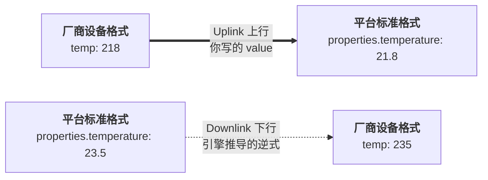
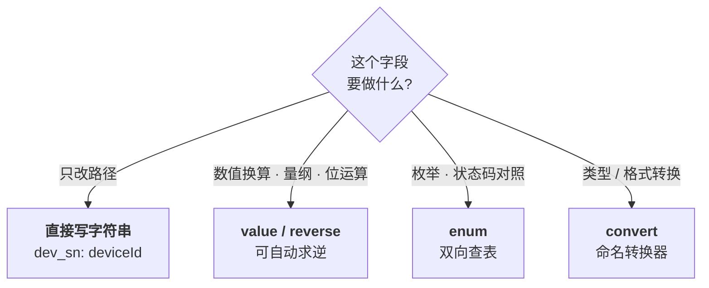

<div align="center">

# json-shift

**IoT 物模型的属性映射库**

一份后台可配的映射关系，在 **平台标准格式** 与 **厂商设备格式** 之间双向转换。

[](https://pkg.go.dev/github.com/itmisx/json-shift)


[](LICENSE)

</div>

```go
s, _ := jsonshift.New(mapping)      // 预编译一次，按产品型号缓存
std, _ := s.Uplink(deviceJSON)      // 上行：设备上报 ──▶ 平台标准格式
dev, _ := s.Downlink(standardJSON)  // 下行：平台标准格式 ──▶ 设备格式，再下发
```

---

## 🧭 核心思想



你只配一条 `temp → properties.temperature`，带一个上行式 `{temp}/10`；下行要用的 `{.}*10` 不用写。

> [!IMPORTANT]
> **一份配置管两个方向** —— 这是本库的核心约束，也是它和通用 JSON 转换器的分界线。

常见做法是把映射写成一串单向算子（取值、拼接、聚合……），表达力强但**不可逆**：下行配一份、上行再配一份，两份各自演化，属性一增删就对不上。

这里把映射表达为一组 **可逆的路径对**，值变换写成 **可自动求逆的表达式**：

| | 常规方案 | json-shift |
| --- | --- | --- |
| 配置份数 | 上行、下行各一份 | **一份** |
| 值变换 | 单向算子链 | 可自动求逆的表达式 |
| `{temp}/10` 的反向 | 手写 `{temp}*10` | **引擎推导** |
| 推不出逆运算时 | 下发时才发现算不回去 | **保存配置时就报错** |

---

<div align="center">

**目录**

[📦 安装](#-安装) · [🚀 快速开始](#-快速开始) · [🧱 映射配置](#-映射配置) · [📍 路径语法](#-路径语法)

[🔀 值变换](#-值变换三选一) → [➗ 表达式](#-表达式可自动求逆) · [🔁 enum](#-enum值对照表) · [🔧 convert](#-convert命名转换器)

[📚 API](#-api) · [🧰 接入要点](#-接入要点) · [📐 语义约定](#-语义约定) · [🚫 非目标](#-非目标) · [🧪 开发](#-开发)

</div>

---

## 📦 安装

```sh
go get github.com/itmisx/json-shift
```

> 需要 Go 1.24+，零第三方依赖。

## 🚀 快速开始

<table>
<tr><th width="50%">1️⃣ 后台存下这份配置</th><th width="50%">2️⃣ 启动时编译一次</th></tr>
<tr valign="top">
<td>

```json
{
  "schema": "github.com/itmisx/json-shift",
  "name": "vendor-x-thermostat",
  "map": {
    "dev_sn": "deviceId",
    "temp":   {
      "key":   "properties.temperature",
      "value": "{temp}/10"
    },
    "sw_st":  {
      "key":  "properties.powerSwitch",
      "enum": [["ON", 1], ["OFF", 0]]
    }
  }
}
```

</td>
<td>

```go
// 配置有错在这一步就暴露，
// 解析 + 预编译一步到位
s, err := jsonshift.Compile(cfg)
if err != nil {
    return err
}

// s 只读，可并发复用
```

</td>
</tr>
</table>

### ⬆️ 上行 —— 设备上报

设备只报了部分属性，没报的自动跳过：

```go
s.Uplink([]byte(`{"dev_sn":"SN-001","temp":218}`))
```
```jsonc
{"deviceId":"SN-001","properties":{"temperature":21.8}}
```

### ⬇️ 下行 —— 下发给设备

同一份配置反向跑，`{temp}/10` 自动求逆成 `{.}*10`：

```go
s.Downlink([]byte(`{"deviceId":"SN-001","properties":{"temperature":23.5,"powerSwitch":"ON"}}`))
```
```jsonc
{"dev_sn":"SN-001","sw_st":1,"temp":235}
```

## 🧱 映射配置

```json
{
  "schema": "github.com/itmisx/json-shift",
  "name": "vendor-x-thermostat",
  "map": {
    "dev_sn": "deviceId",

    "temp":  {"key": "properties.temperature", "value": "{temp}/10",
              "comment": "设备以 0.1℃ 为单位传整数"},
    "degf":  {"key": "properties.ambientC",    "value": "({degf}-32)*5/9"},
    "sw_st": {"key": "properties.powerSwitch", "enum": [["ON", 1], ["OFF", 0]]},
    "rssi":  {"key": "properties.rssi",        "convert": "~string2int"},
    "md":    {"key": "properties.mode",
              "enum": [["cool", 1], ["heat", 2], ["auto", 3]], "default": "auto"}
  }
}
```

`map` 表的 **键是设备侧路径**，值有两种写法：

| 值的写法 | 用在 | 例子 |
| :--- | :--- | :--- |
| 📝 **字符串** | 只改路径 | `"dev_sn": "deviceId"` |
| 🧩 **对象** | 需要值变换 | `"temp": {"key": "...", "value": "{temp}/10"}` |

对象里的 `key` 是平台侧路径，其余都是选项。

> [!TIP]
> 从左到右读正好是 **上行** 的流向：「设备的这个字段，对应平台的那个字段」。
> 下行把两侧互换、并对表达式自动求逆，不用另写一份配置。

### 外层字段

| 字段 | 必填 | 说明 |
| :--- | :-: | :--- |
| `map` | ✅ | 映射表 |
| `schema` | — | 填了必须是 `github.com/itmisx/json-shift` 或 `jsonshift/v1`。用处是将来格式升级时后台能认出旧配置 |
| `name` | — | 仅作标识 |

只有一张表时外层可以整个省掉，直接写 `{"dev_sn": "deviceId"}`。

> [!NOTE]
> - 设备侧字段名正好叫 `map`、`spec`、`schema` 或 `name` 时，必须用完整写法 —— 这四个是外层保留键，会被优先识别。
> - 键的书写顺序被保留。同一目标路径被多条规则命中时，**后写的覆盖先写的**。

> [!WARNING]
> 简写是靠「有没有 `map` 键」识别的。所以写了 `schema`/`name` 却漏掉（或拼错）`map` 表时会直接报错，而不是把它们当成设备侧字段编出一套错规则：
>
> ```console
> jsonshift: 解析映射失败: 出现了外层字段 "schema" 却没有 map 表；完整写法需要 "map": {...}
> ```

> [!NOTE]
> **`spec` 曾是 `map` 的同义别名，现已统一成 `map`。** 一个字段两种拼法会让后台存下同义而不同形的配置；而且 `spec` 在 IoT 语境里指物模型本身（TSL — Thing Specification Language），用来命名一张路径映射表是误导。写了 `spec` 会收到改名提示：
>
> ```console
> jsonshift: 解析映射失败: 顶层字段 "spec" 已改名为 "map"：把 "spec": {...} 改成 "map": {...} 即可
> ```

### 条目选项

| 选项 | 说明 |
| :--- | :--- |
| 🎯 `key` | **平台侧路径** |
| ➗ `value` | 上行表达式：平台值 = f(设备值)。下行表达式由它[自动求逆](#-表达式可自动求逆) |
| ↩️ `reverse` | 下行表达式。只在 `value` 无法自动求逆时才需要写 |
| 🔁 `enum` | [值对照表](#-enum值对照表) `[[平台侧值, 设备侧值], ...]` |
| 🔧 `convert` | [命名转换器](#-convert命名转换器)，处理非算术的类型/格式转换 |
| 🪂 `default` | 源端缺该路径时写入目标端；不设置则该属性整条跳过。写 `null` 就是写 `null`（与不写不同） |
| 📌 `const` | 不读源端，直接写常量到目标端（通常配 `only`，如设备要求固定协议版本号）。不能再配值变换 |
| ❗ `required` | 源端缺该路径时返回错误 |
| 🧭 `only` | `both`（默认）/ `a2b`（仅下行）/ `b2a`（仅上行） |
| 🫗 `omitempty` | 值为 `null` / `""` / 空数组 / 空对象时不写入目标端 |
| 💬 `comment` | 仅作注释，不参与转换 |

> 未知选项会在解析阶段报错，**拼错不会被静默忽略**。

> [!NOTE]
> - `default: null` 与**不写** `default` 是两件事：前者「缺值时写入 `null`」，后者「缺值时整条跳过」。`const: null` 同理。
> - `const` 不读源端，所以它和 `value`/`reverse`、`enum`、`convert` 不能同时出现 —— 那些变换没有输入可做，是死配置，会在解析阶段报错。
> - `default` 写的是**目标侧的字面量**，不经过值变换；它和 `value`/`enum`/`convert` 可以共存（有值走变换，缺值走 `default`）。

## 📍 路径语法

| 写法 | 含义 |
| :--- | :--- |
| `properties.temperature` | 嵌套字段 |
| `t[0]` | 固定数组下标（设备常用定长数组塞多路数据） |
| `ch[*].t` | 数组通配 |
| `[*].t` | 顶层就是数组 |
| `ch[*].sensors[*].v` | 多层嵌套通配 |
| `a\.b` | 字段名里的字面点号（转义） |

### 数组与通配符

`[*]` 在两侧的数量 **不要求相等**，按下面三种情形处理，且两两互逆：

| 情形 | 配置 | 上行行为（下行自动互逆） |
| :--- | :--- | :--- |
| ⚖️ **数量相等** | `ch[*].t` ↔ `properties.channels[*].temperature` | **逐元素映射**，按源端数组长度展开 |
| 📤 **设备侧少一层** | `errs` → `properties.alarmCodes[*].code` | **散开**成 `[{"code":"E01"},{"code":"E07"}]` |
| 📥 **设备侧多一层** | `ch[*].sensors[*].v` → `properties.readings[*]` | **聚集**成数组 `[[1,2],[3]]` |

> [!IMPORTANT]
> 值变换（表达式／`enum`／`convert`）始终作用在 **叶子值** 上，不是整个数组。

## 🔀 值变换：三选一



`value`/`reverse`、`enum`、`convert` 是三套并列的机制，**一条规则只能用一个**：

| 要做的事 | 用哪个 | 例子 |
| :--- | :--- | :--- |
| 数值换算：量纲、偏移、位运算 | ➗ `value` | `"{temp}/10"` |
| 枚举、状态码对照 | 🔁 `enum` | `[["ON", 1], ["OFF", 0]]` |
| 类型或格式转换：字符串↔数字、时间戳、内嵌 JSON | 🔧 `convert` | `"~string2int"` |

## ➗ 表达式（可自动求逆）

这是本库的核心机制。配置里 **只写上行表达式**，下行所需的逆运算由引擎推导：

| 上行 `value` | ➡️ 自动求出的下行表达式 |
| :--- | :--- |
| `{temp}/10` | `{.}*10` |
| `{v}*0.1+2` | `({.}-2)/0.1` |
| `({degf}-32)*5/9` | `(({.}*9)/5)+32` |
| `100-{v}` | `100-{.}` |
| `sqrt({v})` | `{.}^2` |
| `log10({v})` | `10^{.}` |
| `{v}^3` | `{.}^(1/3)` |
| `{v}<<4` | `{.}>>4` |

> [!TIP]
> `{字段名}` 引用该字段的源值，**`{.}` 是它的简写**（路径长时更省事）。
> `Shifter.DerivedReverse(设备侧键)` 返回推导出的下行表达式文本，可以在后台显示给配置者确认。

### ⛔ 推不出逆运算时

**在保存配置时就报错**，而不是等到真的下发指令才发现算不回去：

```console
map["v"]: value "{v}%256" 无法自动求逆: 运算 "%" 不可逆（右移、取模、按位与或、
比较与逻辑运算都会丢信息）；请显式提供另一个方向的表达式，或用 only 限定成单向规则
```

> [!IMPORTANT]
> **「数学上不可逆」不等于「只能上行」。** `reverse` 不要求是数学逆，它就是「下行表达式」，写什么都行。

此时有两条出路：

<table>
<tr><th width="50%">出路一 · 显式写 <code>reverse</code></th><th width="50%">出路二 · 用 <code>only</code> 限定单向</th></tr>
<tr valign="top">
<td>

两向照常都能跑。

```json
"kwh": {
  "key":     "properties.energy",
  "value":   "floor({kwh})/2",
  "reverse": "{.}*2"
}
```

</td>
<td>

另一个方向该属性不出现。

```json
"flags": {
  "key":   "properties.alarm",
  "value": "{flags}>>3&1==1",
  "only":  "b2a"
}
```

</td>
</tr>
</table>

汇总：

| 配置 | ⬆️ 上行 | ⬇️ 下行 |
| :--- | :-: | :-- |
| `value` 可自动求逆 | ✅ | ✅ 引擎推导 |
| `value` + 显式 `reverse` | ✅ | ✅ 你写的那个 |
| `value` + `only: "b2a"` | ✅ | ➖ 该属性不出现 |
| `reverse` + `only: "a2b"` | ➖ 该属性不出现 | ✅ |
| 不可逆，且两者都不给 | ❌ 配置阶段被拒 | ❌ 配置阶段被拒 |

> [!NOTE]
> **单向不限于上行。** `only: "a2b"` 就是只下行，这和物模型的访问权限正好对应 —— 传感器读数、告警位是只读属性，只上报从不下发，给它配个不可逆的上行表达式是对的；只写的属性反过来用 `only: "a2b"`。单向规则在另一个方向是 **静默跳过**，该属性直接不出现在输出里。

> [!IMPORTANT]
> **单向规则的表达式要写在对应的那一边**，引擎不替你猜：
>
> | `only` | 表达式写在 | 另一边 |
> | :--- | :--- | :--- |
> | `b2a`（只上行） | `value` | 写 `reverse` 会报错（它永远不会生效） |
> | `a2b`（只下行） | `reverse` | 写 `value` 会报错（它写的是上行式，含义正好相反） |
>
> 这一条很要紧：`value` 的定义是「平台值 = f(设备值)」。给 `only: "a2b"` 的规则写 `value` 而让引擎自动求逆，算出来的是**反过来**的结果，静默跑错比直接报错糟得多。

> [!WARNING]
> 显式写 `reverse` 时引擎 **不检查往返一致性**。`floor({v}/10)` 配 `{.}*10` 会让 `237 → 23 → 230` 丢掉个位 —— 在「设备只接受整十值」的场景下这是对的，但它确实有损，是否接受由你判断。

### 算子

> [!NOTE]
> 下表所有算子 **都可以用**。✅／❌ 只回答一件事：**要不要你手写另一个方向**。
> ❌ 的算子照常求值，只需配 `only` 或显式 `reverse`。

| 类别 | 算子 | 自动求逆 |
| :--- | :--- | :--- |
| 算术 | `+` `-` `*` `/` | ✅ |
| 幂 | `^`（右结合；`{v}^3`、`2^{v}`） | ✅ |
| 位移 | `<<` `>>` | `<<` ✅ ／ `>>` ❌ 丢低位 |
| 位运算 | `&` `\|` `~` `xor()` | `~` ✅ ／ 其余 ❌ |
| 取模 | `%` | ❌ |
| 比较 | `==` `!=` `<` `<=` `>` `>=` | ❌ |
| 逻辑 | `&&` `\|\|` `!`（短路求值） | ❌ |
| 条件 | `c ? a : b` | ❌ |

**优先级照 Go 的表**：位运算比比较绑得更紧，所以 `{v}&1==1` 读作 `({v}&1)==1`，没有 C 里那个经典的坑。

> [!CAUTION]
> `^` 是 **幂** 而非异或（异或用 `xor(a,b)`），且比一元负号绑得更紧：`-{v}^2` 等于 `-({v}^2)`。

**布尔输出**：比较与逻辑运算的结果按 `true`/`false` 写出（而非 `1`/`0`），所以 `{flags}>>3&1==1` 可以直接喂给平台侧的布尔属性。

**字面量**：十进制、科学计数法 `1e3`、十六进制 `0xFF`、二进制 `0b1010`、`_` 分隔符 `1_000`。常量有 `pi`、`e`。

### 函数

> [!NOTE]
> 下表所有函数 **都可以用**，❌ 的也一样能写进表达式照常求值。
> ✅／❌ 只回答 **要不要你手写另一个方向**，不是「能不能用」。

| 函数 | 自动求逆 | 逆式 |
| :--- | :-: | :--- |
| `sqrt(x)` ／ `cbrt(x)` | ✅ | `y^2` ／ `y^3` |
| `exp(x)` ／ `ln(x)` | ✅ | 互逆 |
| `log10(x)` ／ `log2(x)` | ✅ | `10^y` ／ `2^y` |
| `pow(x,c)` | ✅ | `y^(1/c)`，只能对底数求逆 |
| `sin` `cos` `tan` `asin` `acos` `atan` | ✅ | 互逆，**仅在主值区间上成立** —— 用前确认取值范围 |
| `bool(x)` | ✅ | 把数值按真假写成 `true`/`false` |
| `abs` `floor` `ceil` `round` `trunc` `sign` | ❌ | 配 `only` 或显式写 `reverse` |
| `min` `max` `clamp` `hypot` `atan2` `xor` | ❌ | 配 `only` 或显式写 `reverse` |

`ExprFuncs()` 列出全部已注册函数，带 `*` 的表示可自动求逆。

<details>
<summary><b>❌ 的函数怎么用 —— 两种写法</b></summary>

```jsonc
// 1) 只上行：取整后上报，平台从不下发这个属性
"kwh": {"key": "properties.energy", "value": "round({kwh}/10)", "only": "b2a"}
//   237 ──▶ 24 ；下行该属性不出现

// 2) 双向：自己写下行式
"kwh": {"key": "properties.energy", "value": "round({kwh}/10)", "reverse": "{.}*10"}
//   237 ──▶ 24 ──▶ 240 （有损，但「设备只接受整十值」时正是想要的）
```

`reverse` 里的自引用路径是 **平台侧**（`key` 那条路径），因为下行读的是平台文档 —— 写 `{.}` 更省事，等价。

</details>

<details>
<summary><b>🧩 自定义函数</b></summary>

每个函数自己声明能否求逆 —— 这是本引擎与通用计算器的根本区别：

```go
jsonshift.RegisterFunc(jsonshift.ExprFunc{
    Name:  "parity",
    Arity: 1,
    Fn: func(a []float64) (float64, error) {
        return float64(int64(a[0]) & 1), nil
    },
    // Invert 留空即「不可逆」，含它的表达式须配 only 或显式 reverse
})
```
```jsonc
"w": {"key": "properties.odd", "value": "parity({w})", "only": "b2a"}
//   {"w":7} ──▶ {"properties":{"odd":1}}
```

> [!CAUTION]
> `ExprFunc.Invert` 的签名引用了未导出类型 `exprNode`，**目前只能在包内实现**。
> 包外注册的函数可以正常求值（`Name`/`Arity`/`Fn`/`Bool` 都有效），但无法声明自己的逆式。

> [!IMPORTANT]
> **先注册，再编译。** 表达式里的函数在 `New`/`Compile` 时就解析进了 AST，之后再 `RegisterFunc` 覆盖同名函数**不会**改变已编译的 `Shifter`（这正是「预编译后只读」该有的样子），但也意味着注册晚了会报「未注册的函数」。
>
> 特别注意 Go 的初始化顺序：**包级变量先于同包的 `init()` 执行**。所以别这么写 ——
>
> ```go
> var shifter, _ = jsonshift.Compile(cfg)  // ❌ 此时 myfunc 还没注册
> func init() { jsonshift.RegisterFunc(myFunc) }
> ```
>
> 把注册和编译放进同一个 `init()`（注册在前），或改用 `sync.Once` 懒加载。

</details>

### 限制

- 表达式 **只处理数值**。输入接受数字、布尔（按 `1`/`0`）和数字字符串 —— 设备把数值塞字符串里上报很常见。
- 含 `[*]` 的规则里只能用 `{.}`（当前元素的值），**不能跨字段引用** —— 绝对路径无法表达「当前元素的兄弟字段」。
- 跨字段引用的路径本身也**不能含 `[*]`**：它按整条路径取**单个**值，通配符在这里取不到东西。写了会在保存配置时报错。
- 跨字段引用（如 `{hi}*256+{lo}`）本身可用，但无法自动求逆，须配 `only` 或显式 `reverse`。单个表达式只产出一个值，所以把两个设备字段合成一个平台属性天然只能上行。
- 结果会做一次 **15 位有效数字规整**，消掉 `23.000000000000004` 这类浮点尾差；是整数就按整数输出。

> [!WARNING]
> 规整是一刀切的：无理结果也会被削到 15 位有效数字。`{v}/3` 上行 `10 → 3.33333333333333`，再下行得 `9.99999999999999` 而非 `10`。量纲换算（`/10`、`*0.1`）不受影响，涉及除不尽的系数时请自行评估。

> [!CAUTION]
> 算出 `NaN` 或 `±Inf` 时 **当场报错**，并带上规则、表达式和输入值 —— 这两个都不是合法的 JSON 数值。定义域越界（`asin(4)`）、溢出（`exp(1000)`）、负底数的分数次幂（`(-4)^0.5`）都会触发：
>
> ```console
> jsonshift: map["v"] (v -> properties.x) b2a: 表达式 "acos({v})" 在输入 4 上得到 NaN，
> 不是合法的 JSON 数值（检查定义域、量纲与溢出）
> ```
>
> 三角函数、`exp`、分数次幂的取值范围请在配置时自己确认 —— 这类错误只有拿到真实数据才暴露得出来。

## 🔁 enum：值对照表

```json
"md": {"key": "properties.mode", "enum": [["cool", 1], ["heat", 2], ["auto", 3]]}
```

每项是 `[平台侧值, 设备侧值]`，两侧都可以是任意 JSON 标量（字符串、数字、布尔）。

> [!IMPORTANT]
> - **两侧的值都必须唯一**，否则反向转换结果不确定 —— 这在 `Validate()` 阶段就会报错。唯一性按**数值相等**判断，不看 Go 的类型：`1`、`1.0`、`int64(1)`、`uint8(1)` 是同一个值。
> - 遇到表里没有的值会 **报错并带上该值和路径**。设备上报了未登记的枚举，应当暴露而不是悄悄放过。

## 🔧 convert：命名转换器

类型与格式转换（字符串↔数字、时间戳、内嵌 JSON……）用命名转换器。名字按 **`a侧2b侧`** 命名，也就是 **平台侧 2 设备侧**：

| 名称 | ☁️ 平台侧（a） | 🔌 设备侧（b） |
| :--- | :--- | :--- |
| `string2int` | `"42"` | `42` |
| `string2float` | `"1.5"` | `1.5` |
| `string2bool` | `"true"` | `true` |
| `int2bool` | `1` / `0` | `true` / `false` |
| `lower2upper` | `"ab"` | `"AB"` |
| `unix2rfc3339` | `1700000000` | `"2023-11-14T22:13:20Z"` |
| `millis2rfc3339` | `1700000000000` | `"2023-11-14T22:13:20Z"` |
| `csv2array` | `"x,y"` | `["x","y"]` |
| `json2object` | `"{\"k\":1}"` | `{"k":1}` |

> [!NOTE]
> `csv2array` 反向（数组 → 字符串）只接受**标量元素**：`null` 写成空字段，对象/数组和含逗号的字符串会报错 —— 它们拼成 CSV 后切不回来。

### `~` 前缀：方向反过来

实际场景里方向常常是反的 —— **设备** 才是把数值塞在字符串里、把 JSON 塞在字符串里的那一方。给名字加 `~` 前缀即交换正反方向：

```json
"rssi": {"key": "properties.rssi", "convert": "~string2int"}
```

上行 `{"rssi":"-67"}` 得到数字 `-67`，下行再变回 `"-67"`。

> [!TIP]
> 上表里 **多数转换器在 IoT 场景下都该带 `~`**。`~` 对带参转换器和自定义转换器一样有效。

<details>
<summary><b>🧩 自定义转换器</b></summary>

```go
// 全局注册（可在 init 中）
jsonshift.Register(jsonshift.Converter{
    Name:    "halfKWh",
    Forward: func(v any) (any, error) { return int64(v.(float64) * 2), nil }, // 平台 -> 设备
    Reverse: func(v any) (any, error) { return v.(float64) / 2, nil },        // 设备 -> 平台
})

// 带参转换器族，用法形如 "divide:100"（纯算术建议直接用 value 表达式）
jsonshift.RegisterFactory("divide", func(arg string) (jsonshift.Converter, error) { /* ... */ })

// 或挂在单份映射上，不污染全局
m := &jsonshift.Mapping{
    // Field 是 Go 侧的表示：A 是平台侧，B 是设备侧
    Fields:     []jsonshift.Field{{A: "properties.energy", B: "kwh", Convert: "halfKWh"}},
    Converters: map[string]jsonshift.Converter{"halfKWh": {/* ... */}},
}
```

**查找顺序**：映射私有 → 全局转换器 → 全局转换器族（名字含 `:` 时）。

只实现了单边（`Forward` 或 `Reverse`）的转换器配在双向规则上，会在 `Validate()` 阶段报错，除非用 `only` 限定了方向。

</details>

## 📚 API

### 预编译后复用

创建后只读，可被多个 goroutine 并发调用。

```go
func New(m *Mapping) (*Shifter, error)

func (s *Shifter) Uplink(data []byte) ([]byte, error)   // = BToA，设备上报
func (s *Shifter) Downlink(data []byte) ([]byte, error) // = AToB，下发给设备
func (s *Shifter) Transform(data []byte, dir Direction) ([]byte, error)
func (s *Shifter) TransformValue(src any, dir Direction) (any, error) // 跳过一次编解码
func (s *Shifter) DerivedReverse(deviceKey string) string // 自动求出的下行表达式文本
func (s *Shifter) Mapping() *Mapping
```

> `Uplink` / `Downlink` 是 `BToA` / `AToB` 的别名 —— A 侧是平台、B 侧是设备，用哪套看哪边读起来顺。

### 配置

```go
func Compile(data []byte) (*Shifter, error)      // 解析 + 编译，一步到位（映射只编译一遍）
func ParseMapping(data []byte) (*Mapping, error) // 只解析并校验，不编译
func FromPaths(paths map[string]string) *Mapping  // 用 Go map 构造，按键排序以保证可复现
func (m *Mapping) Validate() error               // 后台保存配置前先校验
```

> `Compile` 等价于 `ParseMapping` + `New`，但省掉中间那次校验编译 —— 网关启动时构建缓存用它最合适。
> 只需要校验配置（后台保存那一步，不需要转换器）时用 `ParseMapping`。

### 一次性用法

内部每次重新编译映射，**热路径请用 `Shifter`**。

```go
func Transform(data []byte, m *Mapping, dir Direction) ([]byte, error)
func TransformValue(src any, m *Mapping, dir Direction) (any, error)
```

### 扩展

```go
func RegisterFunc(f ExprFunc)                         // 表达式函数（可声明逆）
func LookupFunc(name string) (ExprFunc, bool)
func ExprFuncs() []string

func Register(c Converter)                            // 命名转换器
func RegisterFactory(name string, f ConverterFactory) // 带参转换器族
func Lookup(name string) (Converter, bool)
func Converters() []string
```

## 🧰 接入要点

### ① 后台保存配置时先 `Validate()`

路径语法、枚举是否双向唯一、表达式能否求逆、转换器及其参数是否合法，全在这一步暴露。错误信息带规则的设备侧键、两侧路径和方向，便于定位是哪一行配错了：

```console
jsonshift: map["md"]: enum 中设备侧值 1 重复，下行结果将不唯一
jsonshift: map["v"]:  value "{v}%256" 无法自动求逆: 运算 "%" 不可逆……
jsonshift: map["v"]:  reverse 表达式 "{.}/0": 出现除以 0
jsonshift: map["t"]:  value: 引用 {t[*}: 路径 "t[*" 缺少配对的 ']'
jsonshift: map["t"]:  value: 引用 {ch[*].t} 含 [*]；跨字段引用只能是指向单个值的确定路径
jsonshift: map["v"]:  const 直接写常量、不读源端，不能再配 value/reverse、convert 或 enum
jsonshift: map["v"]:  only "a2b" 只走下行，下行表达式请写在 reverse 里；value 写的是上行式……
```

**运行期**的报错用同一套定位（多带一个方向），便于在日志里对照配置：

```console
jsonshift: map["md"] (md -> properties.mode) b2a: 枚举表里没有值 9（float64）
jsonshift: map["ch[*].t"] (ch[*].t -> properties.channels[*].temperature) b2a: 缺少必填字段 ch[1].t
```

### ② 网关按产品型号缓存 `Shifter`

不要每条消息都 `ParseMapping`：

```go
var shifters sync.Map // productKey -> *jsonshift.Shifter
```

`Shifter` 预编译后只读，并发安全。基准（M3 Pro，4 条规则含表达式与枚举）：

| 调用 | 耗时 | 分配 |
| :--- | --: | --: |
| `Uplink` / `Downlink` | ~1.7 µs/op | 1720 B，38 allocs |
| `TransformValue`（上游已解码） | ~0.44 µs/op | 392 B，7 allocs |

> [!TIP]
> 大部分开销是 JSON 编解码，所以上游已经解码过的话走 `TransformValue`。
> 注意它的输出可能与输入 **共享子结构**，请勿就地修改返回值。

### ③ 属性、事件、服务各配一份映射

本库只管一次结构转换。物模型里不同消息类型的形状不同，按类型各建一个 `Shifter` 即可。

## 📐 语义约定

| 约定 | 行为 |
| :--- | :--- |
| 🔒 **只映射声明过的属性** | 配置里没出现的字段不会被带到目标端 —— 避免把设备私有字段漏进平台数据 |
| 🪂 **源端缺该路径** | 有 `default` 写默认值，有 `required` 报错，否则 **整条跳过**。设备上报属性子集是常态，所以默认跳过而非报错 |
| ⭕ **显式 `null`** | 视为「存在」，原样写入目标端，不触发 `default`；值变换对 `null` 跳过、原样透传 |
| 🏗️ **中间层级** | 按需创建；`t[3]` 之前的空洞填 `null` |
| 💥 **目标路径冲突** | 同一位置既当标量又当对象会 **报错**，而不是静默覆盖 |
| 🈳 **一条规则都没命中** | 输出是字面 `null`（而非 `{}`）—— 输入形状完全不对时不会报错，请自行判空 |
| 📭 **源端数组为空** | 目标端物化一个空数组 `[]`（顶层也是数组时，输出就是 `[]`），而不是整条跳过 |
| 💢 **算出 NaN / ±Inf** | **报错**，带规则、表达式和输入值 —— 它们不是合法 JSON 数值，不能放过去 |

## 🚫 非目标

- **自动求逆不可逆的运算。** 取模、右移、按位与或、`abs`/`floor`/`round`、条件分支都会丢信息。引擎不猜，只报错 —— 要用就显式写另一向，或用 `only` 限定单向。
- **字符串处理**（截取、拼接、正则）。表达式是数值引擎。
- **未声明字段的透传**（passthrough）。
- **物模型的取值范围、单位合法性校验。**

## 🧪 开发

```sh
gofmt -l .               # 格式
go vet ./...             # 静态检查
go test ./...            # 单测 + 可执行示例
go test -race ./...      # 并发安全
go test -bench=. ./...   # 基准
go test -cover ./...     # 覆盖率
```

CI（`.github/workflows/ci.yml`）在每次 push / PR 上跑上面全部步骤。

## 📄 许可证

[MIT](LICENSE)
